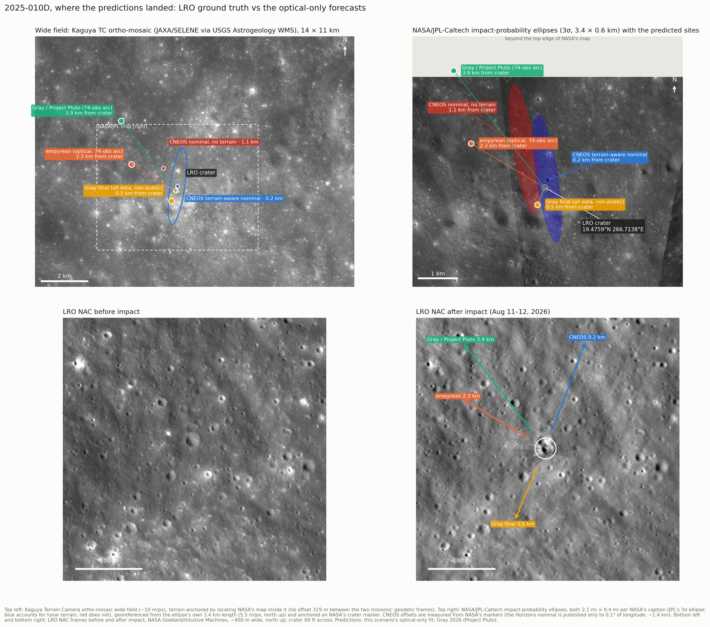

# 2025-010D: a Falcon 9 stage → community-driven astrometry → predicted lunar impact

[](./main.py)
[](./main.rs)
[](./main.ipynb)
[](https://colab.research.google.com/github/Empyrean-Dynamics/empyrean-scenarios/blob/main/2025-010D/main.ipynb)

Prefer a notebook? [`main.ipynb`](./main.ipynb) is the same walkthrough,
rendered on GitHub with executed outputs, or open it in Colab with the
badge above.

## The story

On 2025-01-15 a Falcon 9 launched two lunar landers at once: Firefly's
Blue Ghost Mission 1 and ispace's HAKUTO-R Resilience. The expendable
second stage that performed the trans-lunar injection, catalogued as
**2025-010D** (NORAD 62719), was left in a ~26-day, Moon-crossing high
Earth orbit. Four days later the ATLAS survey picked it up as an unknown
object; it spent a day on the NEO Confirmation Page as **A11hSI1**
before Bill Gray (Project Pluto) identified it as the just-launched
stage.

In September 2025, Gray's orbit solutions began showing a lunar impact
in August 2026. The community trajectory, Gray's solutions and the one
fitted here, is optical only: at lunar distance radar returns are ~10¹⁰ times
fainter than for LEO objects, so it came from telescopic astrometry, NEO surveys
plus a hand-raised network of community observers on four continents who answered
Gray's call for measurements. JPL's reference solution (#GA1A2/21) is the
exception: it adds three radar Doppler measurements to the optical astrometry. The final pre-impact prediction
put the stage on the Moon at **2026-08-05 06:35:37.5 UTC**, near the
crater Einstein at the Moon's western limb, in terrain just past the
90° W line that favorable libration happened to tilt into view from
Earth that morning.

The stage hit on time. The VLT saw a sodium–lithium vapor plume in the
minutes after impact, and KASA's Danuri orbiter (which had imaged
the site 33 minutes *before* impact) caught the fresh scar on its next
passes: the first before/after documentation of an artificial lunar
crater. 2025-010D is the first lunar impactor whose provenance, mass,
and dimensions were all known in advance, making it a genuine
ground-truth calibration object for cislunar orbit determination.

For an orbit-determination engine this object is a stress test that no
asteroid provides: a ~4-tonne hollow tumbling cylinder whose
solar-radiation-pressure area-to-mass ratio (~0.008 m²/kg) is one to
two orders of magnitude above any natural body's, fitted from a public
arc of community-driven astrometry, propagated through the Earth–Moon system
into a hyperbolic selenocentric encounter.

## The data (not the usual MPC query)

Most scenarios in this collection pull their astrometry live from
the Minor Planet Center. This one does not: the observations come from
Bill Gray's Project Pluto pages, which compile the astrometry for
2025-010D (his page reports 1,053 observations as of 2026-02-26). This
directory ships the public-domain part of that record, contributed by
the observers named below, as a committed ADES PSV file:

- [`astrometry.psv`](./astrometry.psv) (raw file:
  <https://raw.githubusercontent.com/Empyrean-Dynamics/empyrean-scenarios/main/2025-010D/astrometry.psv>;
  save it as `astrometry.psv` next to where you run the code): all 402 public observations of
  2025-010D, normalized from the find_orb-extended MPC 80-column format
  of the source pages by [`convert_astrometry.py`](./convert_astrometry.py).
  Normalization means exactly: packed sub-second timestamps and decimal
  day fractions expanded to ISO-8601 UTC at the source's own precision;
  sexagesimal coordinates converted to decimal degrees (find_orb
  decimal-degree lines are copied digit-for-digit); the source's seven
  designation spellings unified to one tracklet ID; magnitudes carrying
  find_orb's exclusion flag omitted; star-catalog codes not carried.
  Nothing else is altered, and no observation is dropped.

Sources, all released to the public domain by Project Pluto (retrieved
2026-08-06):

| Source | Arc | Obs | URL |
|---|---|---|---|
| Pseudo-MPEC for 2025-010D | 2025-12-21 → 2026-05-22 | 323 | <https://www.projectpluto.com/pluto/mpecs/25010d.htm> |
| Pseudo-MPEC, final pre-impact arc | 2026-07-23 → 2026-08-01 | 74 | <https://www.projectpluto.com/pluto/mpecs/25010d_new.htm> |
| NEOCP discovery tracklet A11hSI1 | 2025-01-19/20 | 5 | <https://projectpluto.com/temp/a11hsi1.htm> |

**Observers.** This scenario exists because of the people who took the
measurements, several of them specifically in response to Gray's
request for tracking of this object:

| Code | Station | Observers |
|---|---|---|
| Y82 | LPMR Observatory, Broad Chalke, UK | G. Privett |
| Q62 | iTelescope Observatory, Siding Spring, Australia | Z. Wang |
| P13 | Baihuashan Observatory, Beijing, China | Z. Wang, B. Liu |
| Y05 | SONEAR Wykrota-CEAMIG, Serra da Piedade, Brazil | C. Jacques |
| 718 | Tooele, Utah, USA | P. Wiggins |
| W05 | Tree Gate Farm Observatory, Starkville, Mississippi, USA | J.-F. Gout |
| 970 | Chelmsford, UK | N. James |
| K19 | PASTIS Observatory, Banon, France | C. Demeautis |
| M21 | Schiaparelli Southern Observatory, Hakos, Namibia | A. Aletti, F. Bellini, L. Buzzi, G. Galli |
| W68 | ATLAS Chile, Río Hurtado, Chile | L. Denneau, R. Siverd, J. Tonry, H. Weiland |
| ScT | Roberts Creek 1, British Columbia, Canada (private station) | S. Tilley |

The same attribution is embedded in `astrometry.psv` itself as ADES
observatory/observer context blocks, so the credits travel with the
data.

Orbit solutions, impact predictions, and the astrometry compilation are
the work of **Bill Gray (Project Pluto)**. If you reuse this data,
credit him and the observers above, and see his page
<https://www.projectpluto.com/25010d.htm> (he asks for a link if you
use it).

## What the script does

1. **Reads the committed public astrometry** with `empyrean.read_ades`,
   with no network fetch.

2. **Fits the final nine-night arc as a geocentric orbit.** IOD is told
   this is an Earth-orbiting object (`OriginPolicy` `EXPLICIT`/`EARTH`, because
   heliocentric Gauss is unphysical for a catalogued satellite), then
   the differential correction runs with solar radiation pressure's
   area-to-mass ratio as a solve-for parameter. For a hollow rocket
   stage the AMR is not a small correction: it is the dominant model
   term, and Gray's fit recovers it at ~5σ from nine nights of data.

3. **Propagates into the Moon** on a grid from MJD 61250 (TDB) in steps of
   0.05 days. The trajectory is hyperbolic with respect to the Moon
   (e ≈ 1.055); the event detector reports the surface impact with
   selenographic coordinates.

4. **Compares against the published record and scores the site**: Gray's fit
   to this same public arc (the area-to-mass ratios differ by 2.45 combined
   sigma), JPL's solution #GA1A2/21 (which includes three radar Doppler
   measurements), and the confirmed impact. The script then prints the
   great-circle separation, on a 1737.4 km Moon, of this fit's impact
   (2.27 km) and of Gray's final prediction (0.49 km) from the crater LRO
   imaged at 19.4759°N, 266.7138°E.

## Reference values

| Quantity | Reference value | Source |
|---|---|---|
| Launch | 2025-01-15 06:11 UTC, KSC LC-39A | Blue Ghost 1 / HAKUTO-R 2 mission |
| Impact epoch | 2026-08-05 06:35:40 UTC ± 9 s | JPL Horizons #GA1A2/21 |
| Impact epoch (Gray, all data) | 2026-08-05 06:35:37.5 UTC | Project Pluto, 2026-08-01 |
| Impact epoch (Gray, this public 74-obs arc) | 2026-08-05 06:35:42.45 UTC | Pseudo-MPEC 25010d_new |
| Impact site | 19.46° N, 266.71° E (near crater Einstein) | Project Pluto |
| Impact site (public 74-obs arc) | 19.58° N, 266.63° E | Pseudo-MPEC 25010d_new |
| 3σ surface ellipse | 3.4 × 0.6 km | JPL Horizons #GA1A2/21 |
| Impact speed | 2.43 km/s (Gray); 2.36 km/s (Campbell et al.) | Fernando et al. 2026; Campbell et al. 2026 |
| Area-to-mass ratio (74-obs arc) | 0.0079 ± 0.0017 m²/kg | Pseudo-MPEC 25010d_new |
| Stage mass / size | ~4,000–4,900 kg, ~12–13 m × 3.7–4 m | JPL Horizons; Sky & Telescope; Fernando et al. 2026 |
| Selenocentric e, q | 1.0549, 1303 km | Pseudo-MPEC 25010d_new |
| Confirmation | Na/Li impact plume (VLT); before/after imaging (KASA Danuri) | ESO; KASA, 2026-08-06 |

Notes for the careful reader: the impact time differs between solutions
by seconds. This fit (06:35:40.17 UTC) falls between Gray's 74-observation
solution (06:35:42.45, pseudo-MPEC 25010d_new) and Campbell et al. 2026
(06:35:36.0 ± 5.1 s at 19.497°N, 266.677°E), which differ by 6 s; Gray's final
prediction from his full record is 06:35:37.5 (Project Pluto, 2026-08-01).
Solar radiation pressure on a tumbling hollow body is the
dominant error term in both: Campbell et al. note that standard 1 to 3
parameter models fit well over short arcs and can break down over longer
ones. The single
`ScT` observation is from a private, non-MPC station code the engine
cannot resolve to a site, so evaluation skips it. It appears as the
one rejected row in the residual summary, and both language twins skip
it identically in the ladder (its site coordinates are on the source
page if you want to model it yourself).

## Expected output (rough)

```
402 public observations (Project Pluto, public domain)
74 in the final arc (2026-07-23 → 08-01)
fit: chi2/dof 0.540  RMS RA·cos(d) 0.323" Dec 0.279"  (74/74 obs)
Fitted AMR = 0.0029 ± 0.0011 m²/kg
Gray (same 74-obs arc): 0.0079 ± 0.0017 m²/kg
Ours - Gray = -0.0050 m²/kg, 2.45 combined sigma

Predicted lunar impact (empyrean): 2026-08-05T06:35:40.17Z
  at 19.514°N 266.646°E (selenographic)
Gray (74-obs arc):  2026-08-05T06:35:42.45Z at 19.577°N 266.630°E
JPL #GA1A2/21:      2026-08-05T06:35:40Z ± 9 s at 19.507°N 266.7°E
Confirmed:          2026-08-05 ~06:35 UTC near crater Einstein

Scored against the crater LRO imaged (19.4759°N 266.7138°E), great circle on a 1737.4 km Moon:
  empyrean (this fit, public 74-obs arc)  2.27 km
  Gray's final prediction (all data)      0.49 km
(dropped unregistered community station ScT from scoring)

Final-arc orbit scored against the full 402-obs record:
  own arc   (2026 Jul-Aug)   RMS         0.41"
  Apr-May 2026               RMS       165.29"
  Dec 2025                   RMS      1679.24"
  Jan 2025 discovery         RMS    470390.33"
(Five orders of magnitude across two lunar encounters and a
 changing tumble, consistent with the per-arc solutions
 Project Pluto published; Gray 2026, Campbell et al. 2026.)
```

The result is an impact epoch 0.2 s from JPL's radar-informed solution,
from optical-only public astrometry, plus a residual ladder spanning five
orders of magnitude that shows exactly why every arc of a tumbling
rocket body earns its own fit.

## Ground truth: LRO imaged the crater

NASA's Lunar Reconnaissance Orbiter photographed the impact site on
2026-08-11/12 and located the fresh crater, about 60 ft across, at
**19.4759°N, 266.7138°E** (511 m elevation), inside JPL's final
impact-probability ellipse. Against that ground truth, the optical-only
forecasts land as follows (great-circle offsets on a 1737.4 km sphere):

| Prediction | Site | Offset from crater |
|---|---|---|
| CNEOS / JPL terrain-aware nominal (blue marker on NASA's map) | n/a (3σ ellipse 3.4 × 0.6 km) | 0.2 km, NNE |
| CNEOS / JPL nominal without terrain (red marker) | n/a (3σ ellipse 3.4 × 0.6 km) | 1.1 km, NNW |
| **This scenario** (optical, 74-obs public arc) | 19.514°N, 266.646°E (no site uncertainty is computed) | 2.27 km, WNW |
| Gray / Project Pluto (same 74-obs arc) | 19.577°N, 266.630°E (no uncertainty stated in the pseudo-MPEC) | 3.9 km, NW |



*Top left: Kaguya Terrain Camera ortho-mosaic wide field (JAXA/SELENE via
USGS Astrogeology), with the predicted sites marked. Top right: NASA/JPL-Caltech
impact-probability ellipses (both 2.1 mi × 0.4 mi per NASA's caption, JPL's 3σ
ellipse; the blue one accounts for lunar terrain), georeferenced from the
ellipse's own 3.4 km length (~5.5 m/px, north up) and anchored on the crater
marker. The JPL offsets are measured from NASA's markers rather than from the
Horizons coordinates, which are published only to 0.1° of longitude (~1.4 km).
Bottom left and bottom right: LRO NAC frames before and after the impact, NASA
Goddard/Intuitive Machines, ~400 m wide, north up; the arrows point toward each
prediction, all of which lie outside these frames.* `lro_figure.py` builds the
figure from the NASA release images and the Kaguya mosaic, which are public
domain or freely available (credit as shown).

### Why two kilometers, and what would have done better

Decomposing each miss along the approach direction (the stage arrived
travelling toward azimuth ~52°, 2.42 km/s) separates *when* from *where*:

| Prediction | Along-track | Cross-track |
|---|---|---|
| This scenario (74-obs public arc) | −0.8 km (−0.4 s) | −2.1 km |
| Gray / Project Pluto (74-obs public arc) | 0.0 km | −3.9 km |
| Gray / Project Pluto (final, all data) | +0.1 km | −0.5 km |
| CNEOS / JPL terrain-aware nominal | +0.2 km (+0.1 s) | −0.1 km |

Timing was solved by everyone. The error is cross-track, and every
solution sits on the same side of the ground track. Two comparisons
matter here. First, on the *same* 74-observation public arc, this
scenario's fit (2.27 km miss) and Gray's (3.9 km miss) agree on the impact
time to 2.3 s and land on the same patch of ground, with ours the closer
of the two. That is an independent reproduction of his public-arc result,
not a mismatch. Second, Gray's *final* prediction (2026-08-01) landed
0.49 km from the crater (19.461°N 266.707°E, "near Einstein" on his page).
It uses his full observation record; Gray reports 1,053 observations as
of 2026-02-26. Most of that record is not in the 74-observation public
set shipped here, so his final solution cannot be reproduced from this
directory. The gap between his 3.9 km public-arc fit and his 0.49 km
final is the value of that additional astrometry, the same lever radar
pulls. Gray states a
formal precision of about 0.5 s and 0.01° (~0.3 km) but says he does not
trust it to better than a few seconds and a few kilometers. CNEOS's
no-terrain nominal sits at −1.1 km from the crater, and their
terrain-aware solution pulls it to within 0.2 km (JPL 3σ ellipse
3.4 × 0.6 km). [`amr_sensitivity.py`](./amr_sensitivity.py)
shows where it comes from: holding the solar-radiation-pressure
area-to-mass ratio at a ladder of values and refitting the same
74-observation arc slides the impact site ~0.8 km cross-track per
0.001 m²/kg while the fit quality barely moves (χ²/dof 0.477 at the
solved 0.0029, 0.470 at 0.0050, where the miss collapses to 1.0 km,
and 0.479 at 0.0060). Over nine nights of plane-of-sky astrometry, SRP
is nearly degenerate with the gravitational signal, and the fit cannot
tell 0.003 from 0.006.

That is exactly the degeneracy radar breaks. JPL's #GA1A2/21 is a fit
to 370 measurements spanning 2026-07-20 to 08-04 that includes three
radar Doppler measurements (Horizons solution notes, S. Naidu): five
times the data, an arc reaching the eve of impact, and range-rate
pinning the axis optical astrometry constrains worst. It lands
0.2 km from the crater once lunar terrain is included. Without radar,
the honest improvements are a physically informed AMR prior from the
stage's known mass and dimensions, or reporting the AMR-marginalized
ellipse instead of a point. (A frame mismatch is ruled out: the engine
rotates the DE440 principal-axis orientation into the Mean Earth frame
that Gray, JPL, and LROC all report in.)

## References

- Gray, B. 2026, "A Falcon 9 second stage will hit the moon", Project Pluto, <https://www.projectpluto.com/25010d.htm>; pseudo-MPECs 25010d and 25010d_new (the astrometry, orbit solutions, and impact predictions compared above).
- Campbell, T., Battle, A., Gray, B., Sanchez, J. A., Cantillo, D., LeCorre, L. & Reddy, V. 2026, "Physical Characterization of Moon Impactor 2025-010D", arXiv:2608.00360: independent optical-only orbit solutions and physical characterization.
- Fernando, B., Heldmann, J., Gray, B., et al. 2026, "Observational planning for the 2026 August 5 Falcon 9 Upper Stage lunar impact", arXiv:2607.14625.
- JPL Horizons, target `-162719`, solution #GA1A2/21 (S. Naidu): the radar-informed reference solution and 3σ ellipse quoted above.

## See also

- [Project Pluto: the 2025-010D lunar-impact page](https://www.projectpluto.com/25010d.htm): Gray's running account
- [Campbell et al. 2026, "Physical Characterization of Moon Impactor 2025-010D"](https://arxiv.org/abs/2608.00360)
- [Fernando et al. 2026, "Observational planning for the 2026 August 5 Falcon 9 Upper Stage lunar impact"](https://arxiv.org/abs/2607.14625)
- [Sky & Telescope: "SpaceX booster will hit the Moon this August"](https://skyandtelescope.org/astronomy-news/spacex-booster-will-hit-the-moon-this-august/)
- JPL Horizons target `-162719` (`2025-010D`), solution #GA1A2/21
